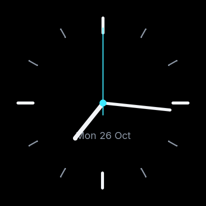

<p align="center">
  <picture>
    <source media="(prefers-color-scheme: dark)" srcset="host/assets/buddy-dark.gif">
    
  </picture>
</p>

# Blinky

[](https://github.com/StefanRiese/blinky-desk-companion/actions/workflows/host.yml?query=branch%3Amain)
[](https://github.com/StefanRiese/blinky-desk-companion/actions/workflows/firmware.yml?query=branch%3Amain)
[](https://github.com/StefanRiese/blinky-desk-companion/actions/workflows/pages.yml?query=branch%3Amain)
[](https://github.com/StefanRiese/blinky-desk-companion/actions/workflows/release.yml)

Blinky is a desk companion with animated mood eyes, weather, indoor climate and custom
data pages, on an ESP32-S3 with a round touch display: the Waveshare
ESP32-S3-Touch-LCD-1.46 (412×412 LCD) or ESP32-S3-Touch-AMOLED-1.75 (466×466 AMOLED).

The device owns its configuration (WiFi, location, data sources, UI settings). When its
WiFi has internet it fetches data itself. Otherwise a small host service, **Buddy Link** (`buddy-link`),
acts as its internet gateway: the device plugs into a laptop over USB (serial), or
connects to a server or container over TCP. `buddy-link` runs on Windows, macOS and Linux
and stores nothing about the device, so you can plug the buddy into any computer.

## Features

**Eyes that react**
- 16 moods (happy, sad, sleepy, hot, cold, dry, angry, surprised, curious, dizzy, love, …) that
  blink, glance around and blend into each other.
- The mood follows the room and the day: hot, cold or dry air indoors, too loud for a while,
  rain or snow outside, night, sunshine. The line under the eyes says why.
- It reacts to you: a tap makes it happy for a moment, a bang startles it, voices make it
  curious, an alarm surprises it. Scripts can set a mood too (`buddy-ctl mood`).

**Pages** (swipe left and right; swipe up goes back to the eyes; which pages and their order
are a setting, `ui.pages`)
- **Dashboard:** clock, date, weather with humidity and wind, indoor temperature and
  humidity, rain expected in the next two hours.
- **Clock:** an analog clock with a second hand and the date.
- **Countdown:** set by swiping, a progress ring along the edge, beeps when it's done.
- **Alarms:** up to four, per weekday, with snooze.
- **Info:** WiFi, the connected hosts and every data source with who fetches it and how
  that goes; a touch tester.
- A **status bar** on every page: time, outdoor temperature (marked when out of date),
  WiFi and host icons, the battery on the AMOLED-1.75.

**At home on the desk**
- Indoor temperature and humidity from an SHT40 sensor; a real-time clock keeps the time
  without power.
- Brighter by day, darker at night, dimmed when nobody touches it.
- The microphone only measures how loud it is: no audio is kept or sent. It can be switched off.
- Units: °C or °F, km/h, mph or m/s, mm or in.

**Data from anywhere**
- With WiFi and internet the device fetches by itself: time (NTP), weather and air quality
  (Open-Meteo, no API key), and any JSON API (values picked with JSON Pointers).
- The location is found by the IP address (ipinfo.io) until you set one by hand, so
  weather and time zone are right without any setup.
- Without internet, **Buddy Link** on a laptop (USB) or a server (TCP, found via mDNS) fetches
  for it, plus host stats (CPU, memory, uptime, temperature). Each source is fetched in one
  place only and moves by itself when WiFi or a host comes or goes.
- Scripts send notifications, moods, values and custom pages through `buddy-ctl`. The emulator
  shows all of them; on the device, custom pages are still to come.

**Easy to set up, no app**
- The [setup page](https://stefanriese.github.io/blinky-desk-companion/) flashes the firmware
  from Chrome or Edge, hands over the WiFi password right after flashing, and edits all
  settings over USB.
- Or without a browser that can do Web Serial: Buddy Link's web UI (or `buddy-ctl flash`)
  flashes a board on USB, and updates connected Blinkies over USB or the network
  ("Update to vX", `buddy-ctl device update`), with the image of the latest release.
- On WiFi, the device has its own settings page at `http://blinky.local/`. Without a network
  it opens the access point **Blinky-Setup**, and joining it opens that page.
- The device keeps all settings itself. Buddy Link stores nothing, so Blinky works with any
  computer it is plugged into.

**Buddy Link** (`buddy-link`): one small program for Windows, macOS and Linux, with a tray icon,
or as a service on a server, in a Proxmox container or with Docker. Several buddies can share one.
Its web UI (tray menu "Open Buddy Link…" or `buddy-ctl gui`) lists the connected buddies,
edits their settings and Buddy Link's own (USB, network, proxy).

**Without hardware:** the emulator (`buddy-sim`) shows the device in the browser, and the
desktop simulator runs the real firmware UI in a window.

## Screenshots

The firmware UI, rendered by the desktop build (412×412, the round display's size). These
images are the references of the screenshot tests, so CI keeps them up to date. All 16
moods and the other states are in [`firmware/test/screenshots/`](firmware/test/screenshots/).

<table>
  <tr>
    <td align="center"><br><sub>neutral</sub></td>
    <td align="center"><br><sub>happy</sub></td>
    <td align="center"><br><sub>love</sub></td>
    <td align="center"><br><sub>sleepy</sub></td>
  </tr>
  <tr>
    <td align="center"><br><sub>dashboard</sub></td>
    <td align="center"><br><sub>countdown</sub></td>
    <td align="center"><br><sub>alarm</sub></td>
    <td align="center"><br><sub>clock</sub></td>
  </tr>
</table>

## Status

| Part | State |
|---|---|
| Host service Buddy Link (`buddy-link`), CLI `buddy-ctl` | working (time, weather, air quality, any JSON API, host stats) |
| Device emulator `buddy-sim` | working: display, eyes, pages, settings, source routing |
| Protocol | specified; covered by tests on both sides (Go and firmware) |
| Firmware | in progress ([M0–M7 in parts](firmware/PLAN.md#to-do)): everything above except notifications, custom pages, forecast and indoor-trend pages, IMU gestures. Builds in CI for both boards; not yet run on a board |
| Hardware | two boards supported (Waveshare ESP32-S3-Touch-LCD-1.46 and -AMOLED-1.75); wiring and case planned |

Plans: [PLAN.md](PLAN.md) · [Firmware](firmware/PLAN.md) · [Host](host/PLAN.md) ·
[Protocol](protocol/PROTOCOL.md) · [Hardware](hardware/PLAN.md)

## Repository

```
host/        Go module: buddy-link (service), buddy-ctl (CLI), buddy-sim (device emulator)
protocol/    NDJSON protocol between device and host, golden example lines
firmware/    ESP32-S3 firmware (ESP-IDF, LVGL), desktop simulator and tests
hardware/    parts, wiring, enclosure plan
site/        setup page (GitHub Pages): flash the firmware, set WiFi, location, alarms, …
deploy/      Proxmox container script, Docker Compose file
```

## Build

### Latest builds of `main`

CI builds every change on `main`. To try it before a release, download the newest builds
(no GitHub login needed; served by [nightly.link](https://nightly.link), a third-party service):

- **Buddy Link** (`buddy-link`, `buddy-ctl`, `buddy-sim` for Windows, macOS, Linux):
  [latest host builds](https://nightly.link/StefanRiese/blinky-desk-companion/workflows/host.yml/main)
- **Firmware** (`blinky-firmware-<board>.bin`, the merged image for each board):
  [latest firmware builds](https://nightly.link/StefanRiese/blinky-desk-companion/workflows/firmware.yml/main)

The same builds on GitHub (needs a login): [host runs](https://github.com/StefanRiese/blinky-desk-companion/actions/workflows/host.yml?query=branch%3Amain+event%3Apush+is%3Asuccess),
[firmware runs](https://github.com/StefanRiese/blinky-desk-companion/actions/workflows/firmware.yml?query=branch%3Amain+event%3Apush+is%3Asuccess);
open the newest run and scroll to "Artifacts". CI keeps them for 14 days, and a workflow only
runs when its part changes, so after a quiet time there may be none: then build it yourself
(below) or take the [latest release](https://github.com/StefanRiese/blinky-desk-companion/releases).
These are development builds; for daily use, take a release.

### Host tools (Go)

Requires **Go 1.27** or newer ([go.dev/dl](https://go.dev/dl/)). With an older Go ≥ 1.21
installed, `go` downloads the right toolchain automatically (`GOTOOLCHAIN=auto`).

```sh
cd host
go build -o bin/ ./cmd/...          # bin/buddy-link, bin/buddy-ctl, bin/buddy-sim
```

No cgo is needed, so you can cross-compile for any platform from any platform:

```sh
GOOS=windows GOARCH=amd64 go build -o bin/windows/ ./cmd/...
GOOS=darwin  GOARCH=arm64 go build -o bin/macos/   ./cmd/...
```

### Firmware

The portable parts (UI, data store, settings, protocol, host link) also build on the desktop,
with a simulator window and the tests. Needs CMake, a C++20 compiler and SDL2
(`apt install libsdl2-dev`); LVGL, ArduinoJson and doctest are fetched by CMake.

```sh
cmake -S firmware/sim -B build/fw-sim -G Ninja
cmake --build build/fw-sim
build/fw-sim/buddy_sim                  # the firmware UI in a window; the mouse is the finger
```

The device image needs [ESP-IDF 6.1](https://docs.espressif.com/projects/esp-idf/en/v6.1/esp32s3/get-started/)
(`cd firmware && idf.py set-target esp32s3 && idf.py build flash monitor`). CI builds it on
every change and keeps the merged image as a download. Details: [firmware/README.md](firmware/README.md).

## Running buddy-link

- **Laptop/desktop (Windows, macOS, Linux):** just start `buddy-link` (or `buddy-link.exe`) and plug
  the buddy in over USB. Nothing to install or configure. On Windows it sits as an icon in
  the lower right of the taskbar, on macOS in the menu bar; its menu shows how many buddies
  are connected, opens the web UI, the config folder and the log, has **Start at login**
  (or `buddy-link install --user`) and **Close**.
- **Server, always on:** on Linux, `sudo buddy-link install` sets it up as a systemd service
  with TCP on port 7531. Devices on the network find it via mDNS when their host link is
  `auto` (setup page → Host computer).
- **Proxmox VE:** run this on the Proxmox host (as root). It creates a small Debian container
  (128 MB RAM, 2 GB disk) and installs `buddy-link` from the latest release (or the newest
  pre-release while there is no regular one):

  ```sh
  bash -c "$(curl -fsSL https://raw.githubusercontent.com/StefanRiese/blinky-desk-companion/main/deploy/proxmox/buddy-link-lxc.sh)"
  ```

  Options like `--ctid`, `--storage`, `--bridge` and `--ip 192.168.1.20/24 --gw 192.168.1.1`,
  or `--update CTID` to update: see the top of
  [`deploy/proxmox/buddy-link-lxc.sh`](deploy/proxmox/buddy-link-lxc.sh). Any number of buddies can
  use one `buddy-link`.

- **Docker Compose** (any server, NAS, or a Proxmox VM with Docker): with
  [`deploy/docker/compose.yml`](deploy/docker/compose.yml), Compose builds the `buddy-link`
  image from this repository and runs it with TCP on 7531. No registry needed:

  ```sh
  docker compose -f compose.yml up -d          # update: add --build
  docker exec buddy-link buddy-ctl devices
  ```

  Host networking lets devices find it via mDNS; with a published port (`7531:7531`) give
  them the IP.

Binaries for all platforms are on the [releases page](https://github.com/StefanRiese/blinky-desk-companion/releases).
On a Mac take `Buddy-Link-macos-universal.zip`: unzip it and move **Buddy Link.app** to
*Applications* (Apple Silicon and Intel). `buddy-ctl-macos-universal` is the command line.
The files aren't signed by Apple yet: allow the first start under *System Settings → Privacy
& Security → Open Anyway*.

## More

- [host/README.md](host/README.md): `buddy-link` config, flags, control API, code layout
- [firmware/README.md](firmware/README.md): firmware layout, simulator, flashing
- [protocol/PROTOCOL.md](protocol/PROTOCOL.md): message reference
