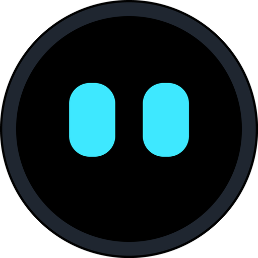

<p align="center"></p>

# ESP32 Desk Buddy

[](https://github.com/StefanRiese/esp32_desk_buddy/actions/workflows/host.yml?query=branch%3Amain)
[](https://github.com/StefanRiese/esp32_desk_buddy/actions/workflows/firmware.yml?query=branch%3Amain)
[](https://github.com/StefanRiese/esp32_desk_buddy/actions/workflows/pages.yml?query=branch%3Amain)
[](https://github.com/StefanRiese/esp32_desk_buddy/actions/workflows/release.yml)

A desk companion with animated mood eyes, weather, indoor climate and custom data pages,
on an ESP32-S3 with a round 412×412 touch display (Waveshare ESP32-S3-Touch-LCD-1.46).

The device owns its configuration (WiFi, location, data sources, UI settings). When its
WiFi has internet it fetches data itself. Otherwise a small host service, **`buddyd`**,
acts as its internet gateway: the device plugs into a laptop over USB (serial), or
connects to a server or container over TCP. `buddyd` runs on Windows, macOS and Linux
and stores nothing about the device, so you can plug the buddy into any computer.

## Screenshots

The firmware UI, rendered by the desktop build (412×412, the round display's size). These
images are the references of the screenshot tests, so CI keeps them up to date. All 16
moods and the other states are in [`firmware/test/screenshots/`](firmware/test/screenshots/).

<table>
  <tr>
    <td align="center"><br><sub>neutral</sub></td>
    <td align="center"><br><sub>happy</sub></td>
    <td align="center"><br><sub>love</sub></td>
    <td align="center"><br><sub>sleepy</sub></td>
  </tr>
  <tr>
    <td align="center"><br><sub>dashboard</sub></td>
    <td align="center"><br><sub>countdown</sub></td>
    <td align="center"><br><sub>alarm</sub></td>
    <td align="center"><br><sub>info</sub></td>
  </tr>
</table>

## Status

| Part | State |
|---|---|
| Host service `buddyd`, CLI `buddyctl` | working (time, weather, air quality, any JSON API, host stats) |
| Device emulator `buddysim` | working: display, eyes, pages, settings, source routing |
| Protocol | specified; covered by tests on both sides (Go and firmware) |
| Firmware | in progress ([M0–M3](firmware/PLAN.md#to-do)): eyes with 16 moods, dashboard, countdown, alarm, settings in flash, SHT40 and RTC drivers, USB link to `buddyd` and the setup page. Builds in CI; not yet run on the board |
| Hardware | board chosen (Waveshare ESP32-S3-Touch-LCD-1.46); wiring and case planned |

Plans: [PLAN.md](PLAN.md) · [Firmware](firmware/PLAN.md) · [Host](host/PLAN.md) ·
[Protocol](protocol/PROTOCOL.md) · [Hardware](hardware/PLAN.md)

## Repository

```
host/        Go module: buddyd (service), buddyctl (CLI), buddysim (device emulator)
protocol/    NDJSON protocol between device and host, golden example lines
firmware/    ESP32-S3 firmware (ESP-IDF, LVGL), desktop simulator and tests
hardware/    parts, wiring, enclosure plan
site/        setup page (GitHub Pages): flash the firmware, set WiFi, location, alarms, …
deploy/      Proxmox container script, Docker Compose file
```

## Build

### Host tools (Go)

Requires **Go 1.27** or newer ([go.dev/dl](https://go.dev/dl/)). With an older Go ≥ 1.21
installed, `go` downloads the right toolchain automatically (`GOTOOLCHAIN=auto`).

```sh
cd host
go build -o bin/ ./cmd/...          # bin/buddyd, bin/buddyctl, bin/buddysim
```

No cgo is needed, so you can cross-compile for any platform from any platform:

```sh
GOOS=windows GOARCH=amd64 go build -o bin/windows/ ./cmd/...
GOOS=darwin  GOARCH=arm64 go build -o bin/macos/   ./cmd/...
```

### Firmware

The portable parts (UI, data store, settings, protocol, host link) also build on the desktop,
with a simulator window and the tests. Needs CMake, a C++20 compiler and SDL2
(`apt install libsdl2-dev`); LVGL, ArduinoJson and doctest are fetched by CMake.

```sh
cmake -S firmware/sim -B build/fw-sim -G Ninja
cmake --build build/fw-sim
build/fw-sim/buddy_sim                  # the firmware UI in a window; the mouse is the finger
```

The device image needs [ESP-IDF 6.1](https://docs.espressif.com/projects/esp-idf/en/v6.1/esp32s3/get-started/)
(`cd firmware && idf.py set-target esp32s3 && idf.py build flash monitor`). CI builds it on
every change and keeps the merged image as a download. Details: [firmware/README.md](firmware/README.md).

## Running buddyd

- **Laptop/desktop (Windows, macOS, Linux):** just start `buddyd` (or `buddyd.exe`) and plug
  the buddy in over USB. Nothing to install or configure. On Windows it sits as an icon in
  the lower right of the taskbar, on macOS in the menu bar; its menu has **Close**.
- **Server, always on:** on Linux, `sudo buddyd install` sets it up as a systemd service
  with TCP on port 7531. Devices on the network find it via mDNS when their host link is
  `auto` (setup page → Host computer).
- **Proxmox VE:** run this on the Proxmox host (as root). It creates a small Debian container
  (128 MB RAM, 2 GB disk) and installs `buddyd` from the latest release:

  ```sh
  bash -c "$(curl -fsSL https://raw.githubusercontent.com/StefanRiese/esp32_desk_buddy/main/deploy/proxmox/buddyd-lxc.sh)"
  ```

  Options like `--ctid`, `--storage`, `--bridge` and `--ip 192.168.1.20/24 --gw 192.168.1.1`,
  or `--update CTID` to update: see the top of
  [`deploy/proxmox/buddyd-lxc.sh`](deploy/proxmox/buddyd-lxc.sh). Any number of buddies can
  use one `buddyd`.

- **Docker** (any server, NAS, or a Proxmox VM with Docker): the image
  `ghcr.io/stefanriese/buddyd` (amd64, arm64, arm/v7) runs `buddyd` with TCP on 7531:

  ```sh
  docker run -d --name buddyd --restart unless-stopped --network host \
    -v buddyd-config:/config ghcr.io/stefanriese/buddyd:latest
  docker exec buddyd buddyctl devices
  ```

  Or with Compose: [`deploy/docker/compose.yml`](deploy/docker/compose.yml). Host networking
  lets devices find it via mDNS; with a published port (`-p 7531:7531`) give them the IP.

Binaries for all platforms are on the [releases page](https://github.com/StefanRiese/esp32_desk_buddy/releases).
On a Mac take `*-macos-universal` (Apple Silicon and Intel). The files aren't signed by
Apple yet: allow the first start under *System Settings → Privacy & Security*.

## More

- [host/README.md](host/README.md): `buddyd` config, flags, control API, code layout
- [firmware/README.md](firmware/README.md): firmware layout, simulator, flashing
- [protocol/PROTOCOL.md](protocol/PROTOCOL.md): message reference
