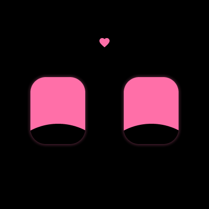
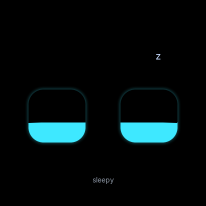
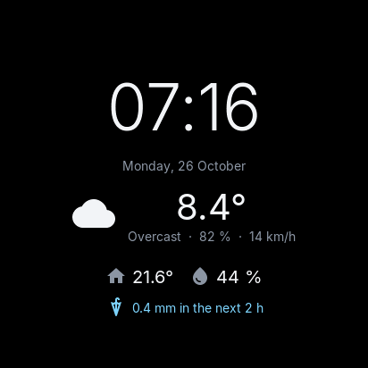
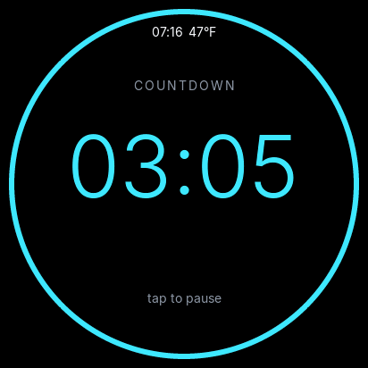
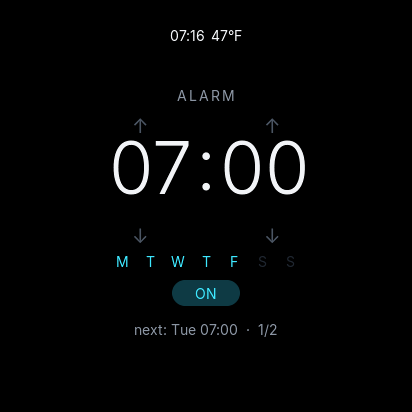
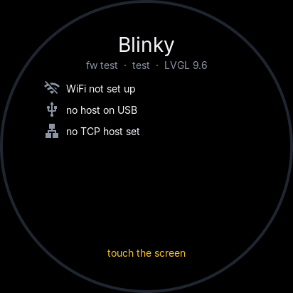

# ESP32 Desk Buddy

[](https://github.com/StefanRiese/esp32_desk_buddy/actions/workflows/host.yml?query=branch%3Amain)
[](https://github.com/StefanRiese/esp32_desk_buddy/actions/workflows/firmware.yml?query=branch%3Amain)
[](https://github.com/StefanRiese/esp32_desk_buddy/actions/workflows/pages.yml?query=branch%3Amain)
[](https://github.com/StefanRiese/esp32_desk_buddy/actions/workflows/release.yml)

A desk companion with animated mood eyes, weather, indoor climate and custom data pages,
on an ESP32-S3 with a round 412×412 touch display (Waveshare ESP32-S3-Touch-LCD-1.46).

The device owns its configuration (WiFi, location, data sources, UI settings). When its
WiFi has internet it fetches data itself. Otherwise a small host service, **`buddyd`**,
acts as its internet gateway: the device plugs into a laptop over USB (serial), or
connects to a server or container over TCP. `buddyd` runs on Windows, macOS and Linux
and stores nothing about the device, so you can plug the buddy into any computer.

## Screenshots

The firmware UI, rendered by the desktop build (412×412, the round display's size). These
images are the references of the screenshot tests, so CI keeps them up to date. All 16
moods and the other states are in [`firmware/test/screenshots/`](firmware/test/screenshots/).

<table>
  <tr>
    <td align="center"><br><sub>neutral</sub></td>
    <td align="center"><br><sub>happy</sub></td>
    <td align="center"><br><sub>love</sub></td>
    <td align="center"><br><sub>sleepy</sub></td>
  </tr>
  <tr>
    <td align="center"><br><sub>dashboard</sub></td>
    <td align="center"><br><sub>countdown</sub></td>
    <td align="center"><br><sub>alarm</sub></td>
    <td align="center"><br><sub>info</sub></td>
  </tr>
</table>

## Status

| Part | State |
|---|---|
| Host service `buddyd`, CLI `buddyctl` | working (time, weather, air quality, any JSON API, host stats) |
| Device emulator `buddysim` | working: display, eyes, pages, settings, source routing |
| Protocol | specified; covered by tests on both sides (Go and firmware) |
| Firmware | in progress ([M0–M3](firmware/PLAN.md#to-do)): eyes with 16 moods, dashboard, countdown, alarm, settings in flash, SHT40 and RTC drivers, USB link to `buddyd` and the setup page. Builds in CI; not yet run on the board |
| Hardware | board chosen (Waveshare ESP32-S3-Touch-LCD-1.46); wiring and case planned |

Plans: [PLAN.md](PLAN.md) · [Firmware](firmware/PLAN.md) · [Host](host/PLAN.md) ·
[Protocol](protocol/PROTOCOL.md) · [Hardware](hardware/PLAN.md)

## Repository

```
host/        Go module: buddyd (service), buddyctl (CLI), buddysim (device emulator)
protocol/    NDJSON protocol between device and host, golden example lines
firmware/    ESP32-S3 firmware (ESP-IDF, LVGL), desktop simulator and tests
hardware/    parts, wiring, enclosure plan
site/        setup page (GitHub Pages): flash the firmware, set WiFi, location, alarms, …
deploy/      Proxmox container script, Docker Compose file
```

## Build

### Host tools (Go)

Requires **Go 1.27** or newer ([go.dev/dl](https://go.dev/dl/)). With an older Go ≥ 1.21
installed, `go` downloads the right toolchain automatically (`GOTOOLCHAIN=auto`).

```sh
cd host
go build -o bin/ ./cmd/...          # bin/buddyd, bin/buddyctl, bin/buddysim
```

No cgo is needed, so you can cross-compile for any platform from any platform:

```sh
GOOS=windows GOARCH=amd64 go build -o bin/windows/ ./cmd/...
GOOS=darwin  GOARCH=arm64 go build -o bin/macos/   ./cmd/...
```

### Firmware

The portable parts (UI, data store, settings, protocol, host link) also build on the desktop,
with a simulator window and the tests. Needs CMake, a C++20 compiler and SDL2
(`apt install libsdl2-dev`); LVGL, ArduinoJson and doctest are fetched by CMake.

```sh
cmake -S firmware/sim -B build/fw-sim -G Ninja
cmake --build build/fw-sim
build/fw-sim/buddy_sim                  # the firmware UI in a window; the mouse is the finger
```

The device image needs [ESP-IDF 6.1](https://docs.espressif.com/projects/esp-idf/en/v6.1/esp32s3/get-started/)
(`cd firmware && idf.py set-target esp32s3 && idf.py build flash monitor`). CI builds it on
every change and keeps the merged image as a download. Details: [firmware/README.md](firmware/README.md).

## Running buddyd

- **Laptop/desktop (Windows, macOS, Linux):** just start `buddyd` (or `buddyd.exe`) and plug
  the buddy in over USB. Nothing to install or configure.
- **Server, always on:** on Linux, `sudo buddyd install` sets it up as a systemd service
  with TCP on port 7531. Devices on the network find it via mDNS when their host link is
  `auto` (setup page → Host computer).
- **Proxmox VE:** run this on the Proxmox host (as root). It creates a small Debian container
  (128 MB RAM, 2 GB disk) and installs `buddyd` from the latest release:

  ```sh
  bash -c "$(curl -fsSL https://raw.githubusercontent.com/StefanRiese/esp32_desk_buddy/main/deploy/proxmox/buddyd-lxc.sh)"
  ```

  Options like `--ctid`, `--storage`, `--bridge` and `--ip 192.168.1.20/24 --gw 192.168.1.1`,
  or `--update CTID` to update: see the top of
  [`deploy/proxmox/buddyd-lxc.sh`](deploy/proxmox/buddyd-lxc.sh). Any number of buddies can
  use one `buddyd`.

- **Docker** (any server, NAS, or a Proxmox VM with Docker): the image
  `ghcr.io/stefanriese/buddyd` (amd64, arm64, arm/v7) runs `buddyd` with TCP on 7531:

  ```sh
  docker run -d --name buddyd --restart unless-stopped --network host \
    -v buddyd-config:/config ghcr.io/stefanriese/buddyd:latest
  docker exec buddyd buddyctl devices
  ```

  Or with Compose: [`deploy/docker/compose.yml`](deploy/docker/compose.yml). Host networking
  lets devices find it via mDNS; with a published port (`-p 7531:7531`) give them the IP.

Binaries for all platforms are on the [releases page](https://github.com/StefanRiese/esp32_desk_buddy/releases).
On a Mac take `*-macos-universal` (Apple Silicon and Intel). The files aren't signed by
Apple yet: allow the first start under *System Settings → Privacy & Security*.

## Testing without hardware

Everything can be developed and tested without an ESP32. `buddysim` emulates the device:
it speaks the same protocol as the firmware, keeps its settings in a JSON file that stands
in for the device's flash (NVS), and shows the round display plus its internals in the
browser. The firmware's own UI runs in the desktop simulator (`buddy_sim`, see
[Build](#firmware)).

Unless noted, the commands below run in `host/` after the build.

### 1. Automated tests

```sh
go test -race ./...                                     # host side, in host/
ctest --test-dir build/fw-sim --output-on-failure       # firmware, from the repo root
```

The Go tests cover:
- protocol encoding and the golden lines in `protocol/examples/`
- the handshake, subscriptions, errors and keepalive of a session
- all data sources, against fake HTTP servers
- the control API and the host config
- the emulator's settings handling
- an end-to-end test: emulator ↔ `buddyd` over real TCP

The firmware tests cover the data store, settings, units, sensor maths, countdown and
alarms, the eyes, the app's navigation, the protocol (replaying the golden lines through the
device's host link) and screenshots of every screen, compared with the references in
[`firmware/test/screenshots/`](firmware/test/screenshots/) (`UPDATE_SCREENSHOTS=1`
regenerates them).

None of the tests need internet access.

### 2. Emulated device over TCP

```sh
# terminal 1: host service with TCP enabled
bin/buddyd --tcp 127.0.0.1:7531

# terminal 2: emulated device; --open starts the browser
bin/buddysim device --host 127.0.0.1:7531 --open
```

The UI is at <http://127.0.0.1:7600>. On the left is the display: drag to swipe pages,
click to tap, or use the **Shake** / long-press buttons. The tabs show:

| Tab | Shows |
|---|---|
| Status | link state, and for each data source who fetches it (device or host) and why |
| Data | every value in the device's data store, with source, age and expiry |
| Messages | every protocol line in both directions (secrets masked) |
| Settings (NVS) | the device settings; edit and save them like on the real device |

### 3. Talk to the device with `buddyctl`

`buddyctl` uses the local control API of `buddyd` (the token is created on the first start
of `buddyd`):

```sh
bin/buddyctl devices                                   # connected devices and their subscriptions
bin/buddyctl notify "Build done" --icon ci_ok --mood happy
bin/buddyctl mood angry --ttl 10
bin/buddyctl data user.coffee=3 --ttl 600
bin/buddyctl page ci --json examples/page-ci.json     # custom page
bin/buddyctl device config --dev buddy-sim01 --get ui
bin/buddyctl device config --dev buddy-sim01 ui.night_from=23
bin/buddyctl monitor                                   # live events and device logs
```

Each command should show up on the emulated display and in the Messages tab.
`buddyctl completion bash|zsh|fish|powershell` prints a shell completion script.

### 4. Scenarios to try

| Scenario | How | Expected |
|---|---|---|
| Unplug the device | uncheck **Host link** | sources go stale, eyes turn sad; recheck → resubscribes |
| Device WiFi has internet | check **Device WiFi has internet** | time, weather and AQI move to the device (Status tab: `via device`); `sys` stays on the host |
| Restart the host service | stop `buddyd` (Ctrl+C), start it again | emulator reconnects and resubscribes by itself; `buddyd` needs no setup |
| Host has no internet | start `buddyd` with `HTTPS_PROXY=http://127.0.0.1:9` | device gets `net:false`; weather and AQI become unavailable (Status tab: "host has no internet"), `time` and `sys` keep working |
| Change device settings | Settings tab, or `buddyctl device config` | new location → new weather; new sources are subscribed at once |
| Any JSON API | add to `sources` in the Settings tab: `{"sid":"btc","src":"http","every":300,"p":{"url":"https://api.coinbase.com/v2/prices/BTC-EUR/spot","pick":{"eur":"/data/amount"}}}` | `btc.eur` appears on the Host page |
| Countdown | go to the last page; drag up/down on the minutes or seconds, then **Shake** | ring around the edge counts down; at zero the page comes to the front, beeps and the eyes look surprised until you shake again; `buddyctl monitor` shows the `countdown` events |
| Alarm | last page; drag up/down on hour or minute, tap for on/off; or `buddyctl device config --dev buddy-sim01 'alarm.list=[{"at":"07:00","on":true}]'` | at that time the page comes to the front and beeps; **Tap** snoozes, **Shake** stops |
| Sound reactions | **👏 Clap**, **🗣 Talk**, the room slider, or tick **mic** to use your microphone (only the level is sent) | clap → startled eyes; talking → curious; room above 70 dB for a while → angry; level on the Indoor page |
| Several devices | run another `buddysim device --nvs b.json --dev buddy-sim02 --http 127.0.0.1:7601 --host 127.0.0.1:7531` | both are listed by `buddyctl devices`; `--dev` targets one |
| Debug the wire | `buddyd --log-level debug` | every line in and out, secrets masked |

### 5. Setup page

The [setup page](https://stefanriese.github.io/esp32_desk_buddy/) flashes the firmware
(once it is published) and edits the device's settings over USB (Web Serial, Chrome/Edge).
To try it against the emulator, let `buddysim` serve it:

```sh
bin/buddysim device --host 127.0.0.1:7531 --site ../site
```

Open <http://127.0.0.1:7600/setup/> and click **Connect to emulator**: WiFi, location (with
place search), host link, display, alarms, sound and data sources are read from and
saved to the emulated device. The emulator's Messages tab shows the `usb:` lines.

### 6. Emulated USB serial

The real device is usually plugged in over USB. A virtual cable pair tests the serial path,
including port handling and the serial handshake.

**Linux / macOS** (needs `socat`):

```sh
socat -d -d pty,raw,echo=0,link=/tmp/ttyHOST pty,raw,echo=0,link=/tmp/ttyDEV &
bin/buddyd --serial /tmp/ttyHOST
bin/buddysim device --serial /tmp/ttyDEV --nvs sim-usb.json
```

**Windows:** create a virtual COM pair with [com0com](https://sourceforge.net/projects/com0com/)
(e.g. `COM10` ↔ `COM11`), then `buddyd --serial COM10` and `buddysim device --serial COM11`.

Without `--serial`, `buddyd` auto-detects real ESP32-S3 boards (USB VID `303a`) and
CH340/CH9102 adapters, so a virtual port has to be named explicitly.

## More

- [host/README.md](host/README.md): `buddyd` config, flags, control API, code layout
- [firmware/README.md](firmware/README.md): firmware layout, simulator, flashing
- [protocol/PROTOCOL.md](protocol/PROTOCOL.md): message reference
